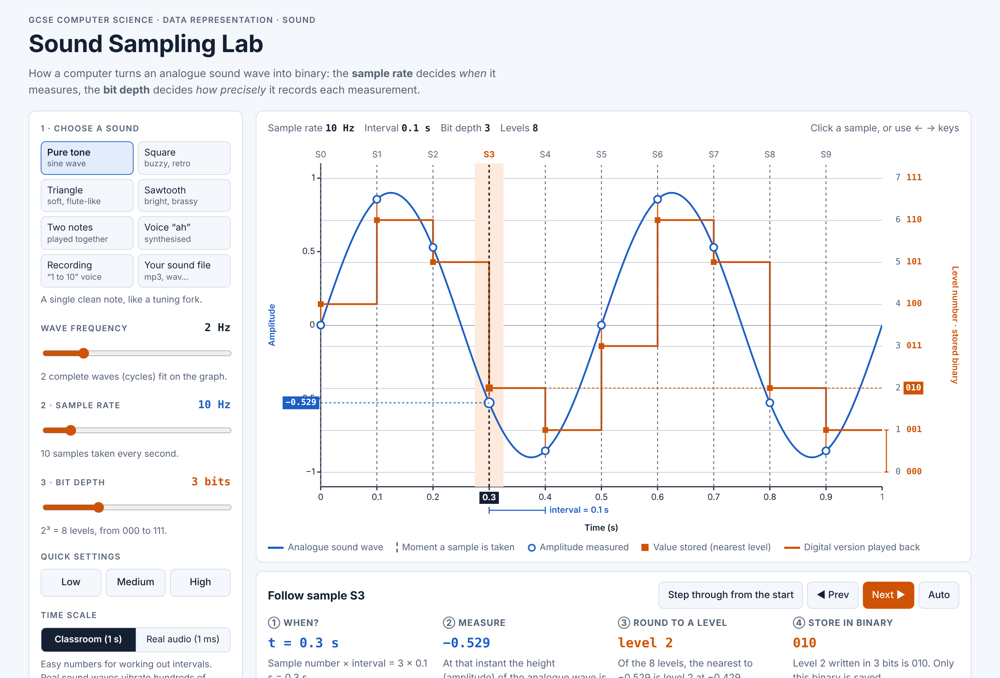

# Sound Sampling Lab

An interactive simulator for teaching how a computer turns an analogue sound wave into binary. It's built for GCSE Computer Science (OCR J277, 1.2 Data representation: sound).

**Live demo:** https://gkakavel.github.io/sound-representation-lab/

## Why I built it

I taught sound representation to a Year 9 class using an existing online sampling demo. Several students still struggled with three questions:

- How exactly are the samples chosen?
- How do we work out the time between samples?
- How does bit depth divide up the y-axis?

This simulator makes each of those steps visible and does the arithmetic on screen.

## What it does

- **Labelled axes.** The x-axis is time, with every sample time marked (S0, S1, S2…) and the interval drawn as a bracket. The y-axis is amplitude (−1 to +1) on the left, with each level's number and binary code on the right.
- **Sample rate.** The interval is worked out live: `interval = 1 ÷ sample rate`, and sample *n* is taken at `n × interval`.
- **Bit depth.** It shows `2^bits` levels, the equal gaps between them, the maximum rounding error (half a gap) and the average error on the graph.
- **Follow one sample.** Click a sample, use the arrow keys, or step through or auto-play from the start. Each sample goes through four stages: when it is taken, the amplitude measured, the nearest level, and the binary stored.
- **Waveforms.** Pure tone, square, triangle, sawtooth, two notes, a synthesised voice "ah", a real voice recording, and any audio file the user uploads.
- **Listen.** Students can play the original and the digitised version to hear the effect of low sample rates and bit depths.
- **Two timescales.** "Classroom" uses 1 second and Hz, so the numbers are easy. "Real audio" uses 1 ms and kHz.
- **File size.** `sample rate × bit depth × duration` is worked out in bits, bytes and KB, alongside a table of every sample and the binary stream that the file would store.

## Running it

It's a single `index.html` file with no build step. Open it in any modern browser, or host it with GitHub Pages.

## Credits

- The "1 to 10" voice recording is from [NCCE Teach Computing](https://teachcomputing.org/) (KS4 Data representation, L12) and is used under the [Open Government Licence v3.0](https://www.nationalarchives.gov.uk/doc/open-government-licence/version/3/).
- The idea was inspired by the sampling demo on [thecomputingteacher.co.uk](https://thecomputingteacher.co.uk/datarepresentation.html). No code was copied.
- Built by Georgios Kakavelakis with the help of Claude (Anthropic).

## Licence

The code is released under the MIT licence; see [LICENSE](LICENSE). The embedded recording stays under the OGL.
